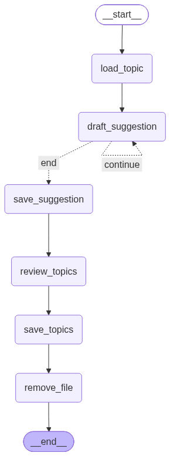

# Small Language Model (SLM) Agentic Reviewer

An automated, local agentic pipeline designed to review, structure and update Quarto-based personal documentation.

## Infrastructure

* **Compute:** Locally hosted on an [Oracle](https://www.oracle.com/) server using 4 ARM CPUs and 24GB RAM.
* **LLMs:** Based on the [Gemma 4](https://deepmind.google/models/gemma/gemma-4/) family (`gemma4:e2b`, `gemma4:e4b`, `gemma4:12b`) via [Ollama](https://ollama.com/).
* **Retrieval Augmented Generation (RAG):** Used to retrieve useful information from the notes, using a vector database created using `embeddinggemma-2`.
* **Framework** Built on the [LangGraph](https://www.langchain.com/langgraph) framework for agents.

## Workflows

### Topic Suggestion

This workflow is currently deployed to manage and expand the `index.qmd` of my personal [mzaiam Website](https://github.com/mZaiam/notes) notes repository. The LLM is used to suggest new topics of a certain section, and then incorporate them into the `index.qmd` file following the previous numbering system.

## Project Structure

